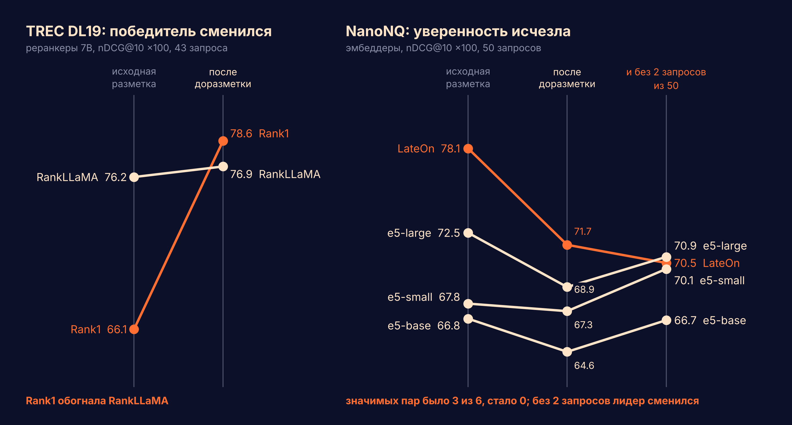

# NanoNQ: доразметка топ-10 LLM-судьями

Вопрос: можно ли сказать «модель A лучше B» на NanoNQ (NanoBEIR, 50 запросов), если в исходной разметке в среднем один релевантный документ на запрос? И что изменится, если доразметить то, что модели реально поднимают в топ-10?

Пост: [@artyfishl](https://t.me/artyfishl).

## Данные
- NanoNQ ([zeta-alpha-ai/NanoNQ](https://huggingface.co/datasets/zeta-alpha-ai/NanoNQ)): 50 запросов, 5 035 пассажей, 54 исходные метки (1.14 на запрос, только положительные). `data/qrels.tsv`, `data/queries.tsv`.
- Прогоны (топ-100 на запрос): BM25, e5-small-v2, e5-base-v2, e5-large-v2, LateOn и еще 5 моделей для сравнения метрик. `data/runs/*.json`, формат `{qid: [[docid, score], ...]}`.
- Пул для разметки: объединение топ-10 пяти моделей, 1 277 пар запрос–пассаж с текстами (`pool5.json`).

## Разметка
- Бинарная, 0/1, один промпт: [`prompt.md`](prompt.md).
- Два независимых судьи вслепую, без исходных меток: A = Claude Opus (`A_labels*.jsonl`), B = Claude Sonnet (`B_labels*.jsonl`). Формат `{"qid", "did", "label", "reason"}`.
- Контроль ложных «да»: 100 пассажей, которых ни одна из 10 моделей не подняла в топ-100, по 2 на запрос (`control.jsonl`, ответы `A_control.jsonl`, `B_control.jsonl`).
- Итоговые метки: «both» (оба судьи сказали 1) — основной вариант, «either» (хотя бы один) — мягкая граница. Третьего судьи нет.

## Согласованность судей
| | |
|---|---|
| Совпадение A и B | 98.6% (1 259 из 1 277) |
| Каппа Коэна | 0.92 |
| Полнота на 54 исходных «да» | A 48/54, B 47/54 |
| Ложные «да» на контроле | A 0/100, B 0/100 |

18 расхождений пограничные: `disagreements.json`. Оговорка: контроль из неподнятых пассажей ловит только грубые ложные срабатывания, точность судей на трудных негативах не измерена.

## Результаты (nDCG@10 ×100, парный перестановочный тест по 50 запросам)
Релевантных на запрос: 1.14 → 2.38 (both) … 2.74 (either). Порядок моделей не меняется: LateOn, e5-large, e5-small, e5-base, BM25.

| Пара | исходная разметка | после доразметки (both) |
|---|---|---|
| LateOn − e5-small | +10.3, 18:6, p=0.03 | +4.4, 14:16, p=0.30 |
| LateOn − e5-base | +11.3, 14:7, p=0.02 | +7.1, 17:12, p=0.09 |
| e5-large − e5-base | +5.7, 16:4, p=0.04 | +4.3, 21:8, p=0.15 |
| LateOn − e5-large | +5.6, 15:10, p=0.21 | +2.8, 17:17, p=0.50 |
| e5-large − e5-small | +4.7, 15:7, p=0.18 | +1.7, 14:14, p=0.58 |
| e5-small − e5-base | +1.0, 9:11, p=0.76 | +2.6, 15:13, p=0.31 |
| все − BM25 | значимо | значимо |

Значимых пар среди плотных моделей: 3 из 6 → 0 из 6 (при мягкой границе 1 из 6). Числа «a:b» — запросы, где первая модель строго лучше и строго хуже.

Хрупкость лидера (`fragility.py`): LateOn − e5-large после доразметки +2.8 при счете 17:17. Убрать 2 запроса из 50 — и первым становится e5-large (70.9 против 70.5). Случайное деление запросов пополам называет разных победителей в 50% случаев.

Какие метрики различают модели лучше (`discriminative.py`, 10 моделей, 45 пар, исходная разметка): nDCG@10, MRR и AP — 21–24 значимых пары; hit@10, P@10 и Recall@100 — 7–8.

Сколько нужно запросов: N ≈ (2.8·σ/Δ)², где σ — стандартное отклонение парной разницы метрики по запросам, Δ — прирост, который хотим поймать (мощность 80%, p<0.05). На NanoNQ σ = 18–30 пунктов, для Δ = 5 это 100–300 запросов.

Проверить свою пару моделей: [`compare.py`](compare.py). Передай метрику обеих моделей по каждому запросу, получишь разницу с интервалом, счет побед и сколько запросов нужно для заданного прироста.



## Запуск
```bash
python analyze.py          # согласованность судей, баллы и пары -> results.json
python fragility.py        # хрупкость LateOn vs e5-large -> drop2.json
python discriminative.py   # чувствительность метрик -> metrics_power.json
python chart_post.py       # картинка для поста -> chart.png
python compare.py          # пример: LateOn vs e5-large, интервал и нужное число запросов
```
Нужны только numpy и matplotlib.
